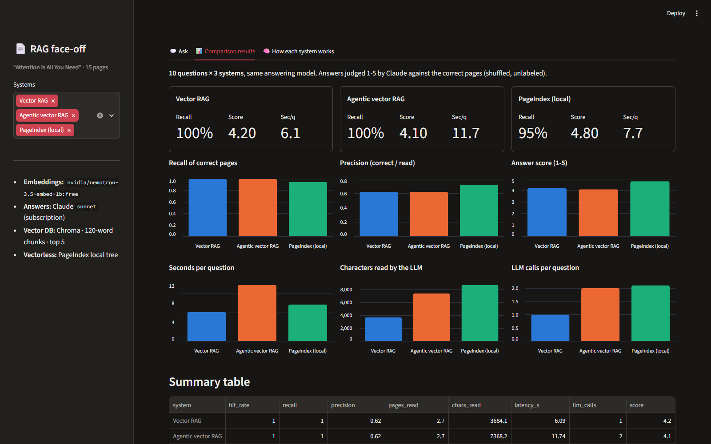
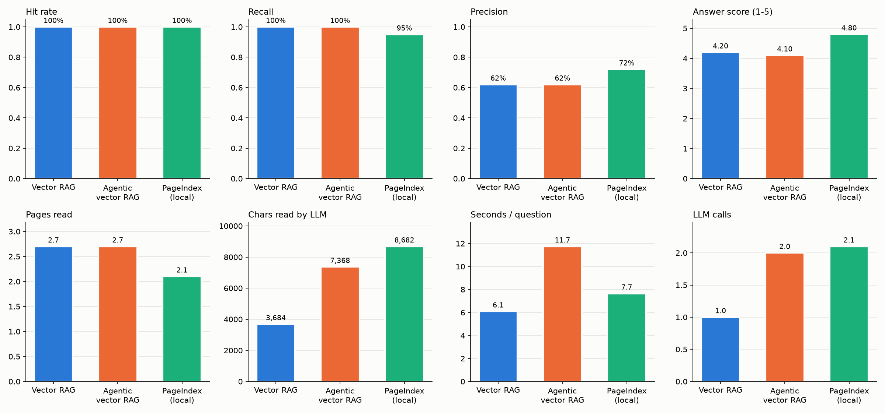
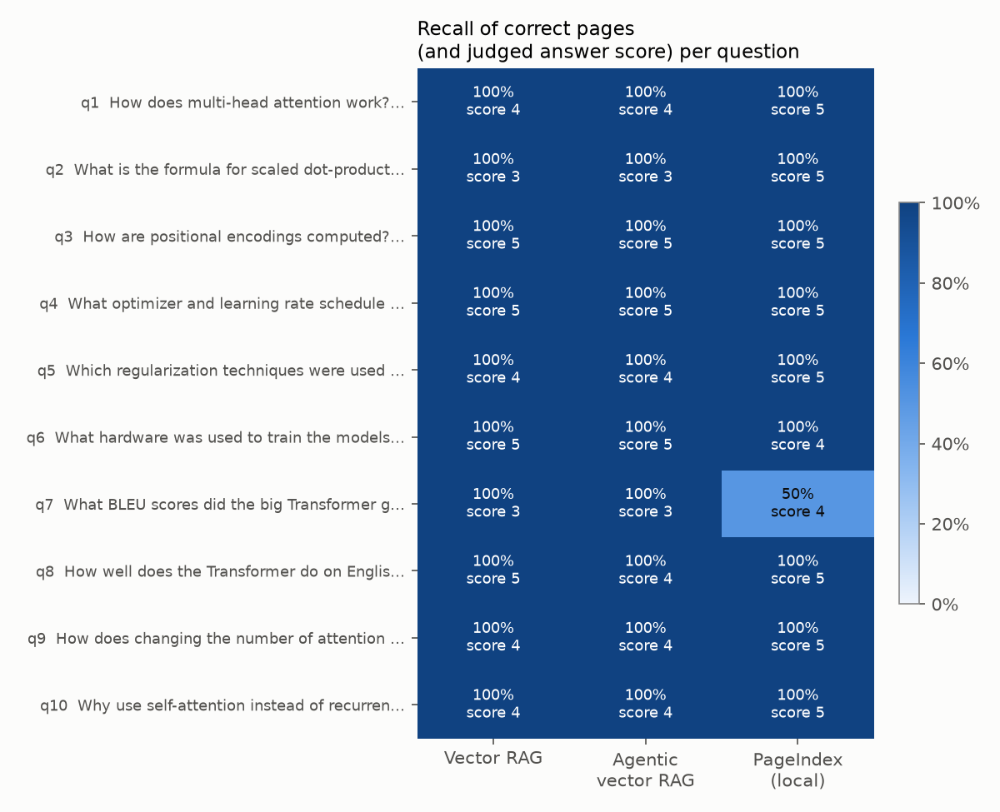
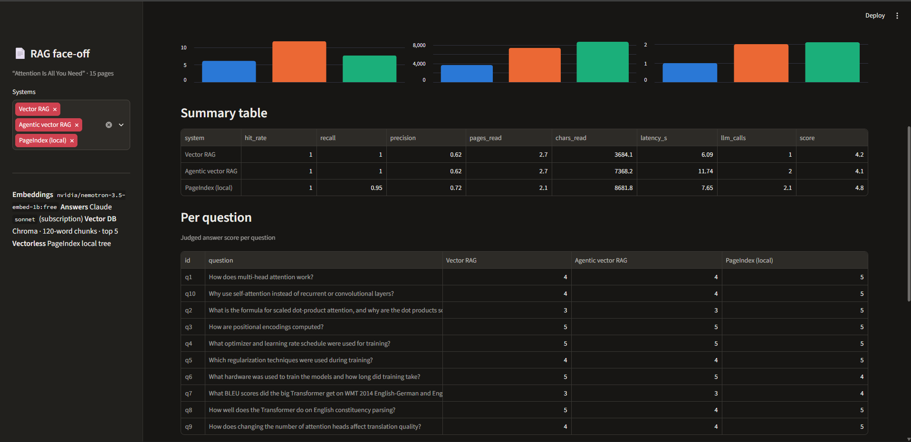
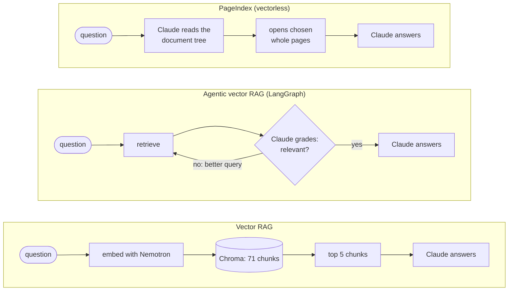
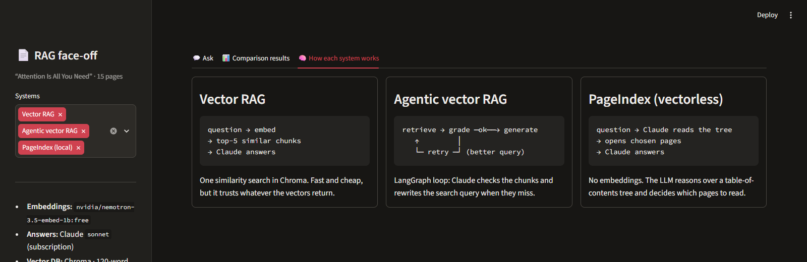

# PageIndex: Vectorless vs VectorDB RAG

Comparing two ways to do RAG (Retrieval-Augmented Generation) on the same document, with the same answering model, to see which retrieval works better.

- **Vectorless RAG**: the document becomes a tree (like a table of contents), and the LLM *reasons* over the tree to pick which pages to read. No embeddings, no vector database. Built with [PageIndex](https://github.com/VectifyAI/PageIndex).
- **VectorDB RAG**: the classic approach. Split into chunks, embed them, store them in a vector DB (Chroma), and retrieve the most similar chunks. Orchestrated with **LangGraph** (a plain graph and an agentic graph that grades and retries).

Test document: [Attention Is All You Need](https://arxiv.org/abs/1706.03762) (`data/Attention.pdf`, 15 pages).



---

## Results

10 questions, each with the correct pages known in advance. Same answering model for every system (**Claude Sonnet**). Answers judged 1-5 by Claude, shuffled and unlabeled.

| | Vector RAG | Agentic vector RAG | PageIndex (local) |
|---|---|---|---|
| Found a correct page | 100% | 100% | 100% |
| Recall of correct pages | **100%** | **100%** | 95% |
| Precision (correct / pages read) | 62% | 62% | **72%** |
| Answer score (1-5) | 4.2 | 4.1 | **4.8** |
| Seconds per question | **6.1** | 11.7 | 7.7 |
| LLM calls per question | **1** | 2 | 2.1 |



### Key takeaways
1. **All three found the right pages.** On a short, well-structured paper, retrieval was easy for every method.
2. **PageIndex gave the best answers (4.8 vs 4.2).** It reads **whole pages**, while vector RAG reads 120-word fragments that cut tables and footnotes in half.
3. **Vector RAG is the fastest and cheapest:** one LLM call and the least text read.
4. **Agentic RAG doubled the cost for no gain here:** its grader accepted the first search every time.
5. **For vectorless RAG, tree quality matters most:** PageIndex's cloud tree is far more accurate than the local one.

<details>
<summary><b>Per-question results</b> (recall of correct pages + judged score)</summary>





</details>

Full write-ups: [Project summary](notes/summary.md) · [VectorDB vs Vectorless results](notes/vectordb_vs_vectorless.md) · [How the VectorDB RAG was built](notes/vectordb_rag.md) · [PageIndex cloud vs local](notes/pageindex_cloud_vs_local.md)

---

## How each system works





---

## Tech stack

| Part | Tool |
|---|---|
| PDF reading | `pypdf` |
| Embeddings | `nvidia/nemotron-3.5-embed-1b:free` via OpenRouter (2048 dimensions) |
| Vector DB | Chroma (on disk) |
| Orchestration | LangGraph |
| Vectorless RAG | PageIndex SDK |
| Answering, grading, judging | Claude Sonnet via `claude-agent-sdk` (runs on a Claude subscription, no API key) |
| Website | Streamlit + Altair |
| Charts | matplotlib |

---

## Project structure

```
src/vectorless_vs_vectordb_rag/
├── config.py                    # paths, model names, RAG settings
├── llm.py                       # ask_claude(): Claude via claude-agent-sdk (subscription)
├── app.py                       # Streamlit website
├── vectorless/
│   ├── pageindex.ipynb          # PageIndex SDK: cloud + local (learning notebook)
│   └── pageindex_rag.py         # PageIndex local + Claude, reports the pages it opened
├── vectordb/
│   ├── vectordb.ipynb           # step-by-step vector RAG + LangGraph (learning notebook)
│   ├── ingest.py                # PDF -> chunks -> embeddings -> Chroma
│   └── rag.py                   # retrieve / generate + plain and agentic LangGraph graphs
└── compare/
    ├── compare.ipynb            # head-to-head evaluation with charts and findings
    └── evaluate.py              # same evaluation as a script
data/                            # input PDFs
results/
├── chroma_db/                   # the vector DB (generated, not committed)
├── pageindex_local/             # PageIndex local tree (generated, not committed)
└── compare/                     # runs.json, CSVs and charts
docs/images/                     # website screenshots
notes/                           # write-ups
CLAUDE.md                        # guidance for Claude Code in this repo
```

---

## Setup

Requires [uv](https://docs.astral.sh/uv/), Python 3.14, and [Claude Code](https://claude.com/claude-code) logged in (answers run on your Claude subscription, no Anthropic API key needed).

```bash
uv sync
```

Create a `.env` file in the project root:

```
OPENROUTER_API_KEY=sk-or-...  # embeddings (free Nemotron model)
PAGEINDEX_API_KEY=...         # only needed for PageIndex cloud mode
```

> OpenRouter's free tier allows **50 requests per day, embeddings included**. Chunks are embedded in one batch and question vectors are saved to `results/query_embeddings.json`, so repeated questions cost nothing.

## Usage

```bash
uv run vectorless-vs-vectordb-rag index                 # build the Chroma DB (once)
uv run vectorless-vs-vectordb-rag ask "How are positional encodings computed?"
uv run vectorless-vs-vectordb-rag compare               # full evaluation (cached in results/compare/runs.json)
uv run vectorless-vs-vectordb-rag app                   # website at http://localhost:8501
```

Or open the notebooks with the `.venv` kernel, in this order: `vectorless/pageindex.ipynb` → `vectordb/vectordb.ipynb` → `compare/compare.ipynb`.


