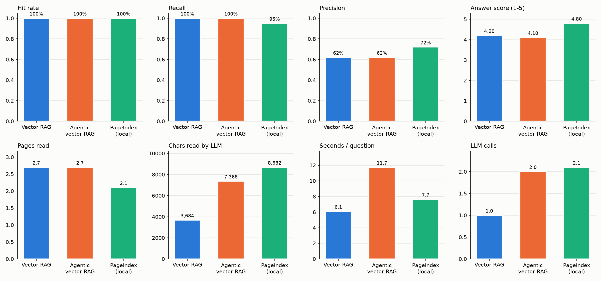

# Project summary: Vectorless vs VectorDB RAG

We built two ways to answer questions about the same PDF ("Attention Is All You Need", 15 pages) and compared them head to head.

---

## What we built

### 1. Vectorless RAG (PageIndex)
- The PDF becomes a **tree** (like a table of contents). The LLM reads the tree, decides which pages to open, and answers from them. No embeddings and no vector database.
- Tried in two modes: **cloud** (PageIndex servers build the tree: 25 nodes, correct structure) and **local** (our own LLM builds it: 14 nodes, flatter, some mistakes).
- Notebook: `vectorless/pageindex.ipynb` · Notes: [pageindex_cloud_vs_local.md](pageindex_cloud_vs_local.md)

### 2. VectorDB RAG
- **PDF → 71 chunks** (120 words each, 30-word overlap, page number kept on every chunk)
- **Embeddings:** `nvidia/nemotron-3.5-embed-1b:free` on OpenRouter (2048 numbers per chunk)
- **Vector DB:** Chroma, saved on disk at `results/chroma_db/`
- **Answers:** Claude Sonnet through `claude-agent-sdk`, running on the Claude subscription (no API key)
- **LangGraph**, two graphs:
  - **Plain RAG:** `retrieve → generate`
  - **Agentic RAG:** `retrieve → grade → (generate | retry with a better query)`
- Notebook: `vectordb/vectordb.ipynb` · Notes: [vectordb_rag.md](vectordb_rag.md)

### 3. Comparison
- 10 questions, each with the **correct pages** checked in the PDF
- 3 systems: Vector RAG, Agentic vector RAG, PageIndex (local). All answered with the same model (Claude Sonnet).
- Measured: right pages found, extra pages read, answer quality (Claude judged the answers shuffled and without system names), speed, LLM calls
- Notebook: `compare/compare.ipynb` · Notes: [vectordb_vs_vectorless.md](vectordb_vs_vectorless.md)

### 4. Python package, command line and website
- Reusable modules: `config.py`, `llm.py`, `vectordb/ingest.py`, `vectordb/rag.py`, `vectorless/pageindex_rag.py`, `compare/evaluate.py`
- Command line: `uv run vectorless-vs-vectordb-rag index | ask | compare | app`
- **Streamlit website** (`app.py`): ask all three systems side by side, see which pages each read, and browse the comparison charts

---

## Results

| | Vector RAG | Agentic vector RAG | PageIndex (local) |
|---|---|---|---|
| Found a correct page | 100% | 100% | 100% |
| Recall of correct pages | **100%** | **100%** | 95% |
| Precision (correct / pages read) | 62% | 62% | **72%** |
| Answer score (1-5) | 4.2 | 4.1 | **4.8** |
| Seconds per question | **6.1** | 11.7 | 7.7 |
| LLM calls per question | **1** | 2 | 2.1 |

### Key takeaways
1. **All three found the right pages.** On a short, well-structured paper, retrieval was easy for every method.
2. **PageIndex gave the best answers (4.8 vs 4.2).** It reads **whole pages**, while vector RAG reads 120-word fragments that cut tables and footnotes in half. The judge's most common complaint about vector answers was "it says the table is cut off".
3. **Vector RAG is the fastest and cheapest:** one LLM call and the least text read.
4. **Agentic RAG doubled the cost for no gain here.** Its grader accepted the first search every time, so the retry loop never ran.
5. **For vectorless RAG, the tree quality matters most.** The cloud tree is far more accurate than the local one.

### When to use which
| Situation | Better choice |
|---|---|
| Many documents, quick factual lookups, low cost | Vector RAG |
| Long structured documents where answers need whole tables or sections | PageIndex (vectorless) |
| Vague questions where the first search often misses | Agentic RAG (with a stricter grader) |

---

## Caveats
- Small test: 10 questions on one short paper.
- The judge is Claude, from the same model family as the answering model.
- PageIndex cloud was not in the comparison (its API key was turned off), only the weaker local tree.

## Next ideas
- **Parent-page retrieval:** search small chunks, then send the whole page they came from. This would give vector RAG the full-page context that helped PageIndex.
- Add PageIndex **cloud** as a fourth system.
- Build vectorless RAG **from scratch**.
