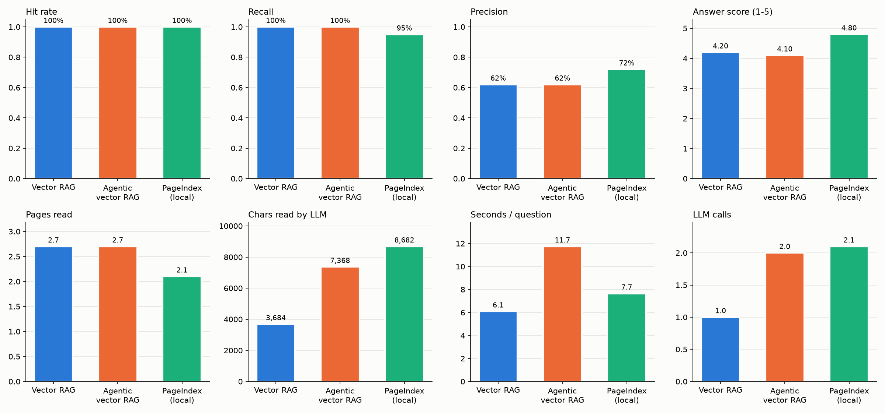
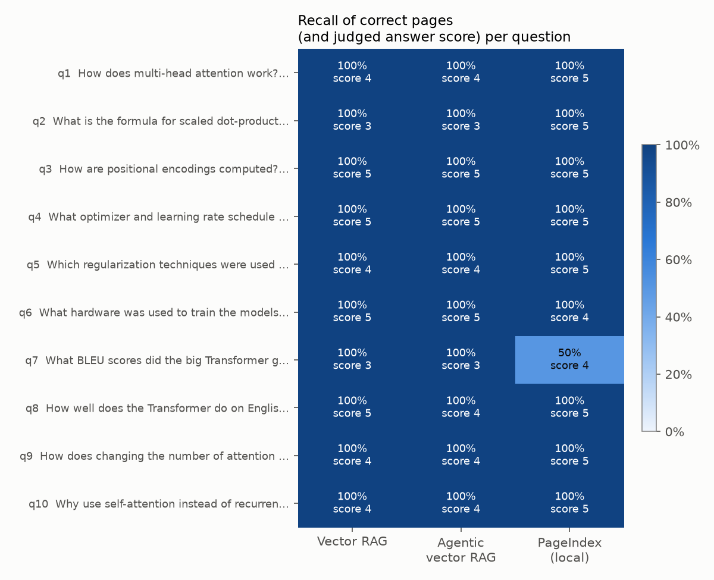

# VectorDB vs Vectorless RAG: results

Three systems, the same 10 questions about "Attention Is All You Need", the same answering model (**Claude Sonnet**, on the Claude subscription). Only the retrieval differs.

Notebook: [`src/vectorless_vs_vectordb_rag/compare/compare.ipynb`](../src/vectorless_vs_vectordb_rag/compare/compare.ipynb)
Script: `uv run vectorless-vs-vectordb-rag compare` ([`compare/evaluate.py`](../src/vectorless_vs_vectordb_rag/compare/evaluate.py))
Raw data: [`results/compare/runs.json`](../results/compare/runs.json), [`per_question.csv`](../results/compare/per_question.csv), [`summary.csv`](../results/compare/summary.csv)

| System | How it finds the text |
|---|---|
| **Vector RAG** | one similarity search in Chroma, top 5 chunks of 120 words |
| **Agentic vector RAG** | similarity search, then Claude grades the chunks and may retry with a better query |
| **PageIndex (local)** | Claude reads the document tree and opens the pages it chooses (whole pages) |

PageIndex **cloud** was not included: `PAGEINDEX_API_KEY` is commented out in `.env`. The local tree is the weaker one (see [pageindex_cloud_vs_local.md](pageindex_cloud_vs_local.md)), so the cloud tree would likely do at least as well.

---

## Results

| | Vector RAG | Agentic vector RAG | PageIndex (local) |
|---|---|---|---|
| Hit rate (read ≥ 1 correct page) | 100% | 100% | 100% |
| Recall of correct pages | **100%** | **100%** | 95% |
| Precision (correct / pages read) | 62% | 62% | **72%** |
| Answer score (1-5, judged) | 4.2 | 4.1 | **4.8** |
| Seconds per question | **6.1** | 11.7 | 7.7 |
| Characters read by the LLM | **3.7k** | 7.4k | 8.7k |
| LLM calls per question | **1** | 2 | 2.1 |

---

## What we learned

### 1. Finding the right page was easy for all three
Short, well-structured paper: every system reached a correct page for every question. Vector search had perfect recall because 5 chunks span ~3 pages, but it also pulled in more unrelated pages (62% precision vs 72%).

### 2. Answer quality depends on *what* the LLM reads
Vector RAG hands Claude **fragments**. The judge's most common complaint about vector answers:
*"it says the table / footnote is cut off, but the reference page contains it"* (q2, q7, q9, q10).
PageIndex opens **whole pages**, so tables and footnotes arrive intact.

> **q9: How does changing the number of attention heads affect quality?**
> Vector RAG: "single-head is 0.9 BLEU worse, too many heads also hurts; the context doesn't give the exact numbers" (score 4)
> PageIndex: quoted Table 3 row by row, h=1: 24.9, 4: 25.5, 8: 25.8, 16: 25.8, 32: 25.4 BLEU (score 5)

### 3. Agentic RAG doubled the cost for no gain on this set
The grader said "relevant" on the first try for all 10 questions, so the retry loop never ran. The grading question (*"does the context contain the answer?"*) passes partial context. Ways to make it useful:
- grade for *completeness*, not just relevance
- on retry, widen the search (bigger `TOP_K`) instead of only rewriting the query

### 4. Cost and speed
Vector RAG is the cheapest: 1 call and the least text. PageIndex reads ~2.4x more text (the tree plus full pages) but is only ~1.5 s slower: its 2 model turns share one Claude Code process, while agentic RAG starts Claude twice.

---

## When to use which

| Situation | Better choice |
|---|---|
| Many documents, quick factual lookups, tight budget | Vector RAG |
| Long structured documents (papers, reports, manuals), answers that need whole tables or sections | PageIndex / vectorless |
| You need an explanation of *why* a page was chosen | PageIndex (the tool calls show its reasoning path) |
| Bad first searches are common (vague questions, jargon mismatch) | Agentic RAG, with a stricter grader |

**Idea to test next:** *parent-page retrieval*. Search small chunks (precise matching), then send the **whole page** each chunk came from (complete context). It combines cheap vector search with the full-page context that made PageIndex's answers better.

---

## Caveats
- 10 questions on one 15-page paper: a small sample on an easy document for vector search.
- The judge is Claude, the same family as the answering model. Answers were shuffled and unlabeled to limit bias.
- PageIndex sometimes added correct facts from the model's own memory (FLOPs in q6); the judge flagged them as "not on the shown page".
- Latency includes ~2 s of Claude Code start-up per call, and 4 runs ran in parallel.
- Answers are cached in `runs.json`; delete it to run everything again from scratch.
